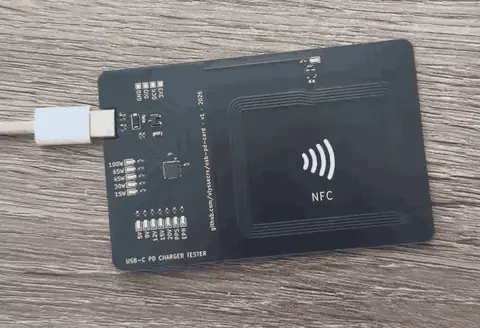

+++
title = "USB-C PD business card"
description = "A credit-card PCB that reads a charger's USB PD offers and lights one LED per voltage. A battery-free NFC tag opens this site on a phone tap."
weight = 10
template = "project.html"

[extra]
featured = true
tags = ["PCB", "USB-C", "NFC", "Firmware"]
image = "plugged.jpg"
image_alt = "The black card plugged into a white USB-C cable, with the 5V, 9V, 15V and 20V LEDs and the 15W and 30W bar lit red, next to the etched NFC coil"
image_caption = "A v1 card on a charger that offers 5, 9, 15 and 20 V, up to 30 W."
kicanvas = true
specs = [
  ["Size", "85.6 × 54 mm"],
  ["Board", "2 layers, 0.6 mm FR4, ENIG"],
  ["Finish", "Black soldermask, white silkscreen"],
  ["Thickness", "About 1.7 mm with parts (estimated)"],
  ["MCU", "WCH CH32X035"],
  ["NFC", "NXP NT3H2111"],
  ["Firmware", "ch32fun, USB PD sink"],
  ["Fab", "JLCPCB fab and assembly"],
]
+++

My business card is a PCB. Plug a USB-C charger into its edge and it lights one LED for each capability the charger advertises: 5, 9, 12, 15 and 20 V, PPS and EPR, plus a 5-LED bar for the maximum wattage (15, 30, 45, 65 and 100 W). Tap it with a phone and a battery-free NFC tag opens this site.

**Status:** the 30 v1 boards arrived from JLCPCB on October 21, 2026, and the first card works. It reads PD offers from every charger I tried, in both plug orientations, and a phone tap opens this site. The NFC range and the coil tuning are not measured yet, and the other 29 cards are not programmed yet.

{{ <fig file="cards.jpg" alt="Two v1 cards on a wooden table. The back shows my name, electronics and embedded systems, the site address, email, GitHub and LinkedIn, a QR code and an NFC symbol. The front shows the LEDs, the MCU, four test pads and the NFC coil" caption="Back and front of v1." /> }}

<figure class="fig"><figcaption>Plugging in: a self-test walk across the LEDs, then the charger's offer.</figcaption></figure>

## How it works

{{ <diagram file="block.svg" caption="Two independent circuits on one board. The USB side runs only when a cable is plugged in. The NFC side runs on energy from the phone's field." /> }}

**USB side.** The card edge is shaped as a USB-C plug tongue, so a cable plugs straight into the board. Both CC lines go to a CH32X035, a small RISC-V MCU with a USB PD PHY built in. Each CC line has its own 5.1 kΩ pull-down, so a charger sees a sink and turns VBUS on before the MCU has booted. The firmware waits for the charger's Source_Capabilities message, parses every power data object (fixed, PPS and EPR), lights the matching LEDs, and then requests 5 V only. The card never asks for a higher voltage.

**NFC side.** An NXP NT3H2111 tag sits at the edge of a spiral coil etched into the PCB. A phone's field powers the tag, which serves an NDEF record with the URL of this site, and the harvested energy also lights one LED. Nothing on this side touches the USB circuit or needs a battery.

{{ <fig file="layout.png" alt="Flat 2D view of the front copper: the electronics and LEDs on a copper pour on the left, the five-turn coil and NFC tag on the right" caption="Front copper and silkscreen. Electronics and ground pour on the left, the coil alone on the right." /> }}

## Bring-up

The firmware is built on [ch32fun](https://github.com/cnlohr/ch32fun) and uses a copy of its USB PD sink library, with fixes. The first card found five problems in that library:

- **One plug orientation failed.** CC2 never attached because the comparator was read only 1 µs after switching between CC1 and CC2. The fix waits 20 µs.
- **Swapped data roles.** The UFP and DFP values of the data-role enum were swapped.
- **Transmit level.** The PHY transmitted at VDD instead of the about 1.1 V the PD spec asks for. The fix enables its low-voltage mode (CC_LVE).
- **A strict charger reset in a loop.** A 33 W GaN charger never acknowledged the Request and sent a hard reset 27 ms later, over and over. A message trace showed the Request going out microseconds after the card's own GoodCRC. A 1 ms gap fixed it.
- **Messages after the contract.** The library did not answer messages the charger sends once the contract is in place. It does now.

**Chargers tested:** Apple 35 W dual, Apple MacBook 70 W, Anker GaN 70 W, a 33 W GaN with PPS, a cheap phone charger (it offers PPS, which its label does not mention), a Lenovo ThinkPad brick, an 18 W power bank, a laptop USB-C port, and generic 3 A chargers without PD. The non-PD chargers and an iPhone used as a source blink the 5 V LED, as designed.

**Flashing.** I do not have a WCH-LinkE, so the cards are programmed with a YD-RP2040 board running an RP2040 PIO programmer from a ch32fun fork, with the wires held on the 1 mm test pads.

**NFC.** The NT3H2111 ships unformatted. Its capability container is all zeros, so iOS reports the tag as not NDEF compliant until two pages are written with raw commands (`A2 04 03 00 FE 00`, then `A2 03 E1 10 6D 00`).

## Design decisions

- **D+ and D− are left unconnected.** On the CH32X035, PC17 is both the USB D+ pin and the BOOT pin, and some chargers drive D+ to about 2.7 V. If PC17 is high at power-up, the MCU starts its bootloader. The card does not need USB data anyway.
- **External Rd resistors.** The CH32X035 cannot present its own Rd without WCH's companion chip, and the pull-downs must be there before any firmware runs.
- **Coil sized to the tag.** The NT3H2111 has about 50 pF of input capacitance, so resonance at 13.56 MHz needs about 2.75 µH. The coil is a 46 × 38 mm rectangle with rounded corners, 5 turns of 0.5 mm track with 0.3 mm gaps, and a bridge on the back for the inner lead. Its estimated inductance as routed is 2.31 µH, which puts it at about 14.4 MHz untuned. That is deliberately high, because a tuning capacitor can only lower the frequency. The board has an empty footprint for one: about 6.6 pF should bring it to 13.56 MHz, but I will choose the value from tests on real boards. These are estimates from a coil script in the repo. The tag already works with the footprint empty, but the frequency and the read range are not measured yet.
- **Coil and electronics on opposite halves.** No copper pour or traces inside or near the coil, and the USB-C plug shell stays at least 5 mm away.
- **Thin parts.** A SOT-23 regulator instead of the SOT-89 I first picked, to keep the card close to credit-card thickness.

## Design files

The KiCad project is public at [github.com/ulyssecrn/usb-pd-card](https://github.com/ulyssecrn/usb-pd-card). The viewers below show v1, the boards in the photos.

{{ <kicanvas repo="ulyssecrn/usb-pd-card" file="usb-pd-card.kicad_sch" label="Schematic" ref="v1" /> }}

{{ <kicanvas repo="ulyssecrn/usb-pd-card" file="usb-pd-card.kicad_pcb" label="PCB layout" ref="v1" /> }}

## Key parts

| Ref | Part | Role | LCSC |
|---|---|---|---|
| U1 | WCH CH32X035G8U6 | MCU with USB PD PHY | [C7437027](https://www.lcsc.com/product-detail/C7437027.html) |
| U3 | NXP NT3H2111W0FHKH | NFC tag with energy harvesting | [C710403](https://www.lcsc.com/product-detail/C710403.html) |
| U2 | Microne ME6228A33M3G | 3.3 V LDO, SOT-23 | [C487914](https://www.lcsc.com/product-detail/C487914.html) |
| D1 | SMF20A | VBUS TVS | [C41411782](https://www.lcsc.com/product-detail/C41411782.html) |
| D3, D4 | H7VL10B | CC line ESD | [C20615787](https://www.lcsc.com/product-detail/C20615787.html) |
| D2, D5 to D16 | KT-0603R | 13 red LEDs | [C2286](https://www.lcsc.com/product-detail/C2286.html) |

The full BOM, with LCSC numbers for every part, is in the repo.

## Lessons

- **Plating on the plug.** After a day of plugging in and out, the ENIG on the USB-C tongue is already wearing. v2 may use hard gold on the edge contacts if the cost allows.
- **Check the NFC chip's factory state.** The tag did not work with iOS until its capability container was written by hand.
- **A message trace beats guessing.** The charger reset loop only made sense once the PD messages were traced.

## Credits

The PCB-edge USB-C footprint is adapted from Nicholas Johnson's [flip-card](https://github.com/Nicholas-L-Johnson/flip-card) (MIT), itself derived from cnlohr's CH32V003 board. I used [Koda's](https://designedbykoda.com/) NFC business card as a reference for the coil geometry, and the NFC symbols on both sides of v1 are Koda's artwork. I will replace them with my own in v2.
